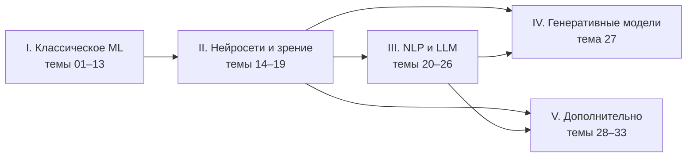

# Машинное обучение: шпаргалка-курс

Конспект курса по классическому машинному обучению и глубокому обучению в одном Jupyter-ноутбуке: 27 тем курса от метрик и деревьев до
трансформеров, LLM-агентов и диффузионных моделей и 6 дополнительных тем. Для каждой темы — краткая часть, подробный конспект с выводами формул, работающий код и
материалы курса (семинары, домашние задания, ссылки).

**Начать: [`cheatsheet.ipynb`](cheatsheet.ipynb)**

[](https://colab.research.google.com/github/thebelkadan/-machine-learning-and-neural-networks/blob/main/cheatsheet.ipynb) [](https://thebelkadan.github.io/-machine-learning-and-neural-networks/)

## Как пользоваться

Каждая тема устроена в два уровня:

1. **Краткая часть** — суть темы, основные понятия и ключевые формулы. Видна сразу, занимает пару страниц.
2. **Конспект** — подробное изложение, разбитое на разделы. Каждый раздел — заголовок со стрелкой, который раскрывается
   по клику (как разделы статьи в Википедии). Среди разделов — выводы формул, вопросы с собеседований (ответ раскрывается
   отдельно), примеры кода с результатами запуска и материалы курса: семинары, задания, видео, внешние курсы.

Темы есть в двух видах: все вместе в ноутбуке [`cheatsheet.ipynb`](cheatsheet.ipynb) (код можно запустить) и отдельными
страницами `topics/NN_*/README.md`. В конце ноутбука — глоссарий всех терминов со ссылками на темы.

- **Новичкам:** идите по порядку: краткая часть, затем нужные разделы конспекта, затем код.
- **Вспомнить тему:** оглавление → нужная тема → краткая часть.
- **Перед собеседованием:** раздел «Вопросы с собеседований» в каждой теме — сначала ответить самому, потом раскрыть.

**Запуск.** Ноутбук читается на GitHub без запуска — выводы сохранены. Блоки независимы: можно запускать любую тему отдельно.
Локально: `pip install -r requirements.txt`; темы 21 и 23–26 скачивают модели и данные с Hugging Face, на CPU работают минутами —
удобнее в Colab с GPU.

## Карта курса



Начинать лучше с главы I по порядку. Главы II–IV опираются на линейные модели и обучение нейросетей (темы 04, 14, 15).
Темы главы V независимы друг от друга — их можно читать в любом порядке, когда пройдены темы из колонки «Опирается на».

## Темы

### I. Классическое машинное обучение

| № | Тема | Опирается на |
|---|---|---|
| 01 | [Введение в ML и метрики регрессии](topics/01_intro_regression_metrics/README.md) | — |
| 02 | [Метрики классификации](topics/02_classification_metrics/README.md) | 01 |
| 03 | [Метрические алгоритмы и kNN](topics/03_knn/README.md) | 01, 02 |
| 04 | [Линейные модели: регрессия, регуляризация, логрег, SVM](topics/04_linear_models/README.md) | 01–03 |
| 05 | [Контроль качества и выбор модели](topics/05_validation/README.md) | 02, 04 |
| 06 | [Сложность моделей, bias–variance, переобучение](topics/06_bias_variance/README.md) | 04, 05 |
| 07 | [Решающие деревья](topics/07_decision_trees/README.md) | 05, 06 |
| 08 | [Ансамбли: бэггинг, случайный лес, стекинг](topics/08_bagging_random_forest/README.md) | 07 |
| 09 | [Градиентный бустинг](topics/09_gradient_boosting/README.md) | 07, 08 |
| 10 | [Обнаружение аномалий](topics/10_anomaly_detection/README.md) | 03, 05 |
| 11 | [Кластеризация и снижение размерности](topics/11_clustering_dim_reduction/README.md) | 03, 04 |
| 12 | [Генерация и отбор признаков](topics/12_feature_engineering_selection/README.md) | 04, 09 |
| 13 | [Рекомендательные системы](topics/13_recommender_systems/README.md) | 04, 11 |

### II. Нейросети и компьютерное зрение

| № | Тема | Опирается на |
|---|---|---|
| 14 | [Нейронные сети и backpropagation](topics/14_neural_networks_backprop/README.md) | 04 |
| 15 | [Обучение нейросетей: инициализация, оптимизаторы, регуляризация, нормализация](topics/15_nn_training/README.md) | 14 |
| 16 | [Свёрточные сети (CNN)](topics/16_cnn/README.md) | 15 |
| 17 | [Семантическая сегментация](topics/17_segmentation/README.md) | 16 |
| 18 | [Детекция объектов](topics/18_detection/README.md) | 16, 17 |
| 19 | [Contrastive learning, эмбеддинги, векторный поиск, интерпретация](topics/19_contrastive_embeddings/README.md) | 16 |

### III. Последовательности, NLP и большие языковые модели

| № | Тема | Опирается на |
|---|---|---|
| 20 | [Рекуррентные сети: RNN, LSTM, GRU](topics/20_rnn/README.md) | 15 |
| 21 | [Представления текста: от мешка слов до word2vec, BPE и контекстных эмбеддингов](topics/21_word_embeddings_tokenization/README.md) | 11, 14 |
| 22 | [Seq2seq и механизм внимания](topics/22_seq2seq_attention/README.md) | 20, 21 |
| 23 | [Трансформер и BERT](topics/23_transformer_bert/README.md) | 22 |
| 24 | [Языковые модели, декодирование, GPT](topics/24_language_models_gpt/README.md) | 23 |
| 25 | [Дообучение LLM: SFT, PEFT (LoRA, QLoRA), выравнивание (RLHF, DPO)](topics/25_llm_finetuning_peft/README.md) | 24 |
| 26 | [Работа с LLM: промптинг, RAG, агенты, запуск и оценка](topics/26_llm_rag_agents/README.md) | 19, 24, 25 |

### IV. Генеративные модели

| № | Тема | Опирается на |
|---|---|---|
| 27 | [Генеративные модели: автокодировщики, VAE, VQ-VAE, GAN, диффузия](topics/27_generative_models/README.md) | 16, 23 |

### V. Дополнительно

Темы за пределами лекций курса: по курсам из списка ссылок (DL2 HSE, NLP ШАД, CS231n, CS336), учебнику ML Яндекса и классическим учебникам.

| № | Тема | Опирается на |
|---|---|---|
| 28 | [Vision Transformer, self-supervised и мультимодальные модели](topics/28_vit_ssl_multimodal/README.md) | 16, 19, 23 |
| 29 | [Эффективное обучение и инференс: точность вычислений, память, квантизация, дистилляция](topics/29_efficient_training_inference/README.md) | 15, 24 |
| 30 | [Интерпретируемость моделей: важность признаков, PDP, SHAP, LIME](topics/30_interpretability/README.md) | 07, 08, 12 |
| 31 | [Обучение с подкреплением: от уравнения Беллмана до PPO и RLHF](topics/31_reinforcement_learning/README.md) | 14, 25 |
| 32 | [Графовые нейросети](topics/32_graph_neural_networks/README.md) | 11, 13, 21 |
| 33 | [Временные ряды: прогнозирование, валидация, модели](topics/33_time_series/README.md) | 05, 20 |

## Структура репозитория

```
cheatsheet.ipynb        главный ноутбук: все темы, код, выводы, глоссарий
topics/NN_тема/         README.md — тема отдельной страницей: краткая часть и конспект
materials/
  seminars/             семинары (ноутбуки), в т.ч. сохранённые копии Colab
  homework/             задания и решения домашних работ
  data/                 небольшие датасеты
SOURCES.md              откуда что взято, внешние ссылки, что не вошло
requirements.txt        зависимости для локального запуска
```

## О материалах

Лекции курса в репозиторий не включены — они принадлежат авторам курса; в конспектах указано, на какую лекцию опирается каждая тема. Семинары и задания в `materials/` также принадлежат авторам курса и приводятся для личного обучения. Большие датасеты (рецензии
Кинопоиска, данные МТС для рекомендаций) в репозиторий не включены — откуда их взять, написано в [SOURCES.md](SOURCES.md).
