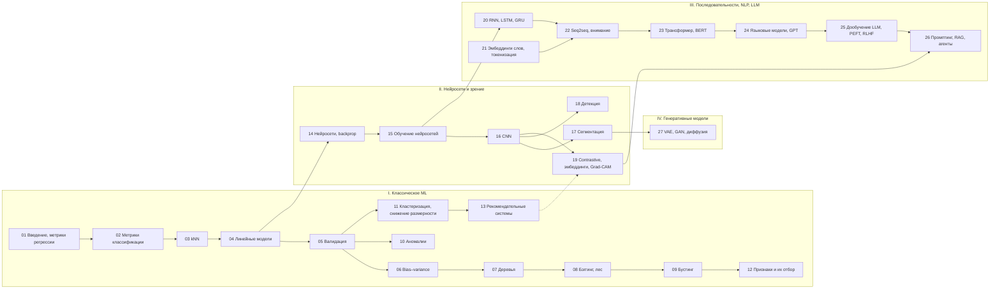

# Машинное обучение: шпаргалка-курс

Конспект курса по классическому машинному обучению и глубокому обучению в одном Jupyter-ноутбуке: 27 тем от метрик и деревьев до
трансформеров, LLM-агентов и диффузионных моделей. Для каждой темы — краткая часть, подробный конспект с выводами формул, работающий код и
материалы курса (семинары, домашние задания, ссылки).

**Начать: [`cheatsheet.ipynb`](cheatsheet.ipynb)**

[](https://colab.research.google.com/github/thebelkadan/-machine-learning-and-neural-networks/blob/main/cheatsheet.ipynb) [](https://thebelkadan.github.io/-machine-learning-and-neural-networks/)

## Как пользоваться

Каждая тема устроена в два уровня:

1. **Краткая часть** — суть темы, основные понятия и ключевые формулы. Видна сразу, занимает пару страниц.
2. **Конспект** — подробное изложение, разбитое на разделы. Каждый раздел — заголовок со стрелкой, который раскрывается
   по клику (как разделы статьи в Википедии). Среди разделов — выводы формул, вопросы с собеседований (ответ раскрывается
   отдельно), примеры кода с результатами запуска и материалы курса: семинары, задания, видео, внешние курсы.

Темы есть в двух видах: все вместе в ноутбуке [`cheatsheet.ipynb`](cheatsheet.ipynb) (код можно запустить) и отдельными
страницами `topics/NN_*/README.md`. В конце ноутбука — глоссарий всех терминов со ссылками на темы.

- **Новичкам:** идите по порядку: краткая часть, затем нужные разделы конспекта, затем код.
- **Вспомнить тему:** оглавление → нужная тема → краткая часть.
- **Перед собеседованием:** раздел «Вопросы с собеседований» в каждой теме — сначала ответить самому, потом раскрыть.

**Запуск.** Ноутбук читается на GitHub без запуска — выводы сохранены. Блоки независимы: можно запускать любую тему отдельно.
Локально: `pip install -r requirements.txt`; темы 21 и 23–26 скачивают модели и данные с Hugging Face, на CPU работают минутами —
удобнее в Colab с GPU.

## Карта курса



## Темы

| № | Тема |
|---|---|
| 01 | [Введение в ML, метрики регрессии](topics/01_intro_regression_metrics/README.md) |
| 02 | [Метрики классификации](topics/02_classification_metrics/README.md) |
| 03 | [Метрические методы, kNN](topics/03_knn/README.md) |
| 04 | [Линейные модели](topics/04_linear_models/README.md) |
| 05 | [Валидация и выбор модели](topics/05_validation/README.md) |
| 06 | [Bias–variance, сложность моделей](topics/06_bias_variance/README.md) |
| 07 | [Решающие деревья](topics/07_decision_trees/README.md) |
| 08 | [Бэггинг и случайный лес](topics/08_bagging_random_forest/README.md) |
| 09 | [Градиентный бустинг](topics/09_gradient_boosting/README.md) |
| 10 | [Обнаружение аномалий](topics/10_anomaly_detection/README.md) |
| 11 | [Кластеризация и снижение размерности](topics/11_clustering_dim_reduction/README.md) |
| 12 | [Генерация и отбор признаков](topics/12_feature_engineering_selection/README.md) |
| 13 | [Рекомендательные системы](topics/13_recommender_systems/README.md) |
| 14 | [Нейросети и backpropagation](topics/14_neural_networks_backprop/README.md) |
| 15 | [Обучение нейросетей](topics/15_nn_training/README.md) |
| 16 | [Свёрточные сети](topics/16_cnn/README.md) |
| 17 | [Семантическая сегментация](topics/17_segmentation/README.md) |
| 18 | [Детекция объектов](topics/18_detection/README.md) |
| 19 | [Contrastive learning, векторный поиск, интерпретация](topics/19_contrastive_embeddings/README.md) |
| 20 | [Рекуррентные сети](topics/20_rnn/README.md) |
| 21 | [Представления текста и токенизация](topics/21_word_embeddings_tokenization/README.md) |
| 22 | [Seq2seq и внимание](topics/22_seq2seq_attention/README.md) |
| 23 | [Трансформер и BERT](topics/23_transformer_bert/README.md) |
| 24 | [Языковые модели, декодирование, GPT](topics/24_language_models_gpt/README.md) |
| 25 | [Дообучение LLM: SFT, LoRA, RLHF, DPO](topics/25_llm_finetuning_peft/README.md) |
| 26 | [Промптинг, RAG, агенты](topics/26_llm_rag_agents/README.md) |
| 27 | [Генеративные модели: VAE, GAN, диффузия](topics/27_generative_models/README.md) |

## Структура репозитория

```
cheatsheet.ipynb        главный ноутбук: все темы, код, выводы, глоссарий
topics/NN_тема/         README.md — тема отдельной страницей: краткая часть и конспект
materials/
  seminars/             семинары (ноутбуки), в т.ч. сохранённые копии Colab
  homework/             задания и решения домашних работ
  data/                 небольшие датасеты
SOURCES.md              откуда что взято, внешние ссылки, что не вошло
_config.yml, _toc.yml   настройки сайта (Jupyter Book)
.github/workflows/      сборка сайта и подстановка ссылок
requirements.txt        зависимости для локального запуска
```

## Публикация на GitHub

1. Запушить в ветку `main`.
2. Включить сайт: **Settings → Pages → Build and deployment → Source: GitHub Actions**. Workflow `site` соберёт сайт
   (Jupyter Book: оглавление, поиск, формулы) и опубликует его на `https://<владелец>.github.io/<репозиторий>/`.
3. Workflow `links` сам подставит адрес репозитория в кнопки «Open in Colab» и «Сайт» (вместо заглушек в ссылках).

GitHub Pages для приватного репозитория доступен только на платных тарифах.

Локальная сборка сайта: `pip install "jupyter-book<2" sphinxcontrib-mermaid`, затем `jupyter-book build .` (результат в `_build/html`).

## О материалах

Лекции курса в репозиторий не включены — они принадлежат авторам курса; в конспектах указано, на какую лекцию опирается каждая тема. Семинары и задания в `materials/` также принадлежат авторам курса и приводятся для личного обучения. Большие датасеты (рецензии
Кинопоиска, данные МТС для рекомендаций) в репозиторий не включены — откуда их взять, написано в [SOURCES.md](SOURCES.md).
