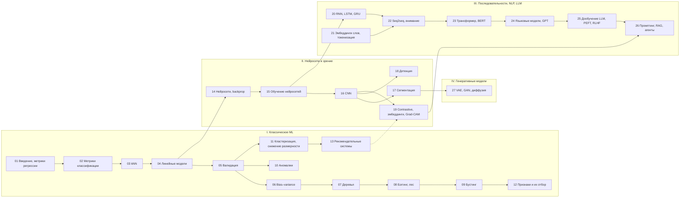

# 🧠 Машинное обучение: шпаргалка-курс

Конспект курса по классическому машинному обучению и глубокому обучению в одном Jupyter-ноутбуке: 27 тем от метрик и деревьев до
трансформеров, LLM-агентов и диффузионных моделей. Для каждой темы — шпаргалка, подробный конспект и математика, работающий код и
материалы курса (лекции, семинары, домашние задания).

**➡️ Начать: [`cheatsheet.ipynb`](cheatsheet.ipynb)**

[](https://colab.research.google.com/github/thebelkadan/-machine-learning-and-neural-networks/blob/main/cheatsheet.ipynb) [](https://thebelkadan.github.io/-machine-learning-and-neural-networks/)

## Как пользоваться

Каждая тема — блок из трёх уровней:

| Уровень | Что внутри |
|---|---|
| ⚡ **Шпаргалка** | суть в одном абзаце, таблица терминов, ключевые формулы, код, который запускается, ловушки и вопросы с собеседований (ответы раскрываются по клику) |
| 📖 **Подробный конспект** | интуиция, алгоритмы, разбор лекций, семинаров и ДЗ, чек-лист, что почитать — раскрывается кнопкой в ноутбуке и лежит отдельным файлом `topics/NN_*/README.md` |
| 🔬 **Математика и выводы** | доказательства и выводы формул — кнопкой в ноутбуке и файлом `topics/NN_*/deep.md` |

Внизу каждого блока — ссылки на лекции, семинары и ДЗ из `materials/`, на исходные Colab-ноутбуки, видео и внешние курсы, и навигация
«← предыдущая · ↑ оглавление · следующая →». В конце ноутбука — глоссарий всех терминов со ссылками на темы.

- **Новичкам:** идите по порядку, читайте шпаргалку, запускайте код, раскрывайте конспект там, где непонятно.
- **Вспомнить тему:** оглавление → нужный блок → таблица терминов и ловушки.
- **Перед собеседованием:** раздел «❓ Ловушки и вопросы» в каждой теме — сначала ответить самому, потом раскрыть.

**Запуск.** Ноутбук читается на GitHub без запуска — выводы сохранены. Блоки независимы: можно запускать любую тему отдельно.
Локально: `pip install -r requirements.txt`; темы 21 и 23–26 скачивают модели и данные с Hugging Face, на CPU работают минутами —
удобнее в Colab с GPU.

## Карта курса



## Темы

| № | Тема | Конспект | Математика |
|---|---|---|---|
| 01 | Введение в ML, метрики регрессии | [README](topics/01_intro_regression_metrics/README.md) | [deep](topics/01_intro_regression_metrics/deep.md) |
| 02 | Метрики классификации | [README](topics/02_classification_metrics/README.md) | [deep](topics/02_classification_metrics/deep.md) |
| 03 | Метрические методы, kNN | [README](topics/03_knn/README.md) | [deep](topics/03_knn/deep.md) |
| 04 | Линейные модели | [README](topics/04_linear_models/README.md) | [deep](topics/04_linear_models/deep.md) |
| 05 | Валидация и выбор модели | [README](topics/05_validation/README.md) | [deep](topics/05_validation/deep.md) |
| 06 | Bias–variance, сложность моделей | [README](topics/06_bias_variance/README.md) | [deep](topics/06_bias_variance/deep.md) |
| 07 | Решающие деревья | [README](topics/07_decision_trees/README.md) | [deep](topics/07_decision_trees/deep.md) |
| 08 | Бэггинг и случайный лес | [README](topics/08_bagging_random_forest/README.md) | [deep](topics/08_bagging_random_forest/deep.md) |
| 09 | Градиентный бустинг | [README](topics/09_gradient_boosting/README.md) | [deep](topics/09_gradient_boosting/deep.md) |
| 10 | Обнаружение аномалий | [README](topics/10_anomaly_detection/README.md) | [deep](topics/10_anomaly_detection/deep.md) |
| 11 | Кластеризация и снижение размерности | [README](topics/11_clustering_dim_reduction/README.md) | [deep](topics/11_clustering_dim_reduction/deep.md) |
| 12 | Генерация и отбор признаков | [README](topics/12_feature_engineering_selection/README.md) | [deep](topics/12_feature_engineering_selection/deep.md) |
| 13 | Рекомендательные системы | [README](topics/13_recommender_systems/README.md) | [deep](topics/13_recommender_systems/deep.md) |
| 14 | Нейросети и backpropagation | [README](topics/14_neural_networks_backprop/README.md) | [deep](topics/14_neural_networks_backprop/deep.md) |
| 15 | Обучение нейросетей | [README](topics/15_nn_training/README.md) | [deep](topics/15_nn_training/deep.md) |
| 16 | Свёрточные сети | [README](topics/16_cnn/README.md) | [deep](topics/16_cnn/deep.md) |
| 17 | Семантическая сегментация | [README](topics/17_segmentation/README.md) | [deep](topics/17_segmentation/deep.md) |
| 18 | Детекция объектов | [README](topics/18_detection/README.md) | [deep](topics/18_detection/deep.md) |
| 19 | Contrastive learning, векторный поиск, интерпретация | [README](topics/19_contrastive_embeddings/README.md) | [deep](topics/19_contrastive_embeddings/deep.md) |
| 20 | Рекуррентные сети | [README](topics/20_rnn/README.md) | [deep](topics/20_rnn/deep.md) |
| 21 | Представления текста и токенизация | [README](topics/21_word_embeddings_tokenization/README.md) | [deep](topics/21_word_embeddings_tokenization/deep.md) |
| 22 | Seq2seq и внимание | [README](topics/22_seq2seq_attention/README.md) | [deep](topics/22_seq2seq_attention/deep.md) |
| 23 | Трансформер и BERT | [README](topics/23_transformer_bert/README.md) | [deep](topics/23_transformer_bert/deep.md) |
| 24 | Языковые модели, декодирование, GPT | [README](topics/24_language_models_gpt/README.md) | [deep](topics/24_language_models_gpt/deep.md) |
| 25 | Дообучение LLM: SFT, LoRA, RLHF, DPO | [README](topics/25_llm_finetuning_peft/README.md) | [deep](topics/25_llm_finetuning_peft/deep.md) |
| 26 | Промптинг, RAG, агенты | [README](topics/26_llm_rag_agents/README.md) | [deep](topics/26_llm_rag_agents/deep.md) |
| 27 | Генеративные модели: VAE, GAN, диффузия | [README](topics/27_generative_models/README.md) | [deep](topics/27_generative_models/deep.md) |

## Структура репозитория

```
cheatsheet.ipynb        главный ноутбук: все темы, код, выводы, глоссарий
topics/NN_тема/         README.md — подробный конспект, deep.md — математика и выводы
materials/
  seminars/             семинары (ноутбуки), в т.ч. сохранённые копии Colab
  homework/             задания и решения домашних работ
  data/                 небольшие датасеты
SOURCES.md              откуда что взято, внешние ссылки, что не вошло
_config.yml, _toc.yml   настройки сайта (Jupyter Book)
.github/workflows/      сборка сайта и подстановка ссылок
requirements.txt        зависимости для локального запуска
```

## Публикация на GitHub

1. Запушить в ветку `main`.
2. Включить сайт: **Settings → Pages → Build and deployment → Source: GitHub Actions**. Workflow `site` соберёт сайт
   (Jupyter Book: оглавление, поиск, формулы) и опубликует его на `https://<владелец>.github.io/<репозиторий>/`.
3. Workflow `links` сам подставит адрес репозитория в кнопки «Open in Colab» и «Сайт» (вместо заглушек в ссылках).

GitHub Pages для приватного репозитория доступен только на платных тарифах.

Локальная сборка сайта: `pip install "jupyter-book<2" sphinxcontrib-mermaid`, затем `jupyter-book build .` (результат в `_build/html`).

## О материалах

Лекции курса в репозиторий не включены — они принадлежат авторам курса; в конспектах указано, на какую лекцию опирается каждая тема. Семинары и задания в `materials/` также принадлежат авторам курса и приводятся для личного обучения. Большие датасеты (рецензии
Кинопоиска, данные МТС для рекомендаций) в репозиторий не включены — откуда их взять, написано в [SOURCES.md](SOURCES.md).
